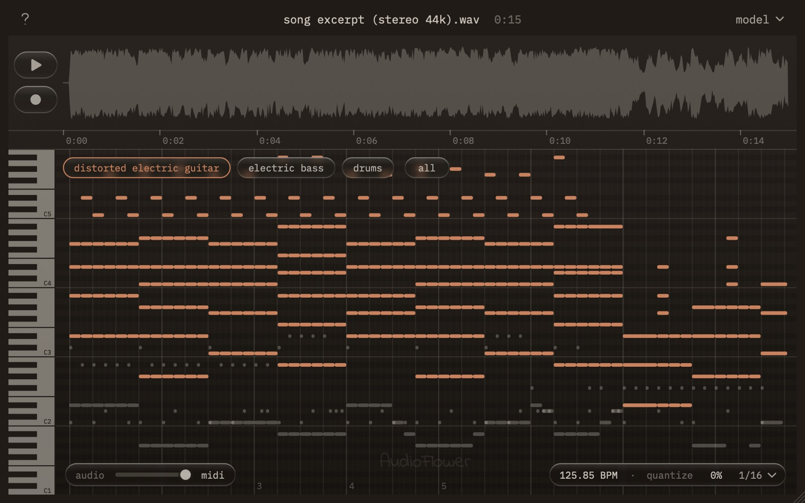

# Audio to MIDI

**[audioflower.art](https://audioflower.art)** · **[Download 1.0.0](https://github.com/lukeglad/audio-to-midi/releases/latest)**

Turns audio into MIDI, one clip per instrument. Drop in a song, a loop or a voice
memo, or record straight from your DAW, and drag the MIDI for each instrument it
hears onto a track. For macOS on Apple Silicon.



## What it does

| | |
|---|---|
| Input | WAV, AIFF, MP3, M4A, FLAC, OGG and more, up to 15 minutes, or a recording from the DAW track it sits on |
| Output | A MIDI file per instrument, or one file with a track each; drums on channel 10 |
| Timing | Tempo detected (or the DAW's, for a recording), quantize 0–100% to 1/4, 1/8 or 1/16 |
| Preview | Plays the notes through real instruments (GeneralUser GS), with a fader back to the original audio |
| Transcription | [MuScriptor](https://github.com/muscriptor/muscriptor), running locally on the GPU through [muscriptor.cpp](https://github.com/DamRsn/muscriptor.cpp); three model sizes, each downloaded once on first use |
| Formats | AU and VST3 effect, standalone app — macOS 11+, Apple Silicon |

Nothing leaves your Mac: the only download is the model itself.

## License

The code is AGPLv3 — see [LICENSE](LICENSE). This is JUCE's open-source option,
and it's copyleft: anyone who builds on this and ships it has to publish their
source too. Copyright remains mine.

The transcription model is **not** part of this repository. It is downloaded by
the plugin and licensed by its authors (Kyutai and Mirelo) under
[CC BY-NC 4.0](https://creativecommons.org/licenses/by-nc/4.0/), so Audio to MIDI
is free for **non-commercial use only**. Only transcribe audio you have the
rights to.

Everything else it ships with, and their licences, is in
[THIRD-PARTY-NOTICES.md](THIRD-PARTY-NOTICES.md).

## Building it

Requires Xcode 26 or later with its Metal toolchain
(`xcodebuild -downloadComponent MetalToolchain`), and [JUCE 8](https://juce.com/get-juce/)
(8.0.13) at `~/Documents/JUCE`; to use a copy elsewhere, run
`JUCE_DIR=/path/to/JUCE ./build.sh`.

```bash
git clone --recursive https://github.com/lukeglad/audio-to-midi.git
cd audio-to-midi
./build.sh
```

`build.sh` sets up CMake and Ninja in a local `.tools/` folder and fetches the
preview's soundfont (pinned and checked against its digest). The first configure
also fetches ggml for the transcription engine, so it needs a network connection.
The AU, VST3 and app land in `build/Release/AudioToMidi_artefacts/Release/`.

`./package.sh --skip-notarize` builds the signed installer, and `./package.sh`
also notarizes it; both need your own Developer ID certificates.

`atm-cli` (built alongside) runs the whole pipeline without a host and carries
the project's checks: `--tempo-check`, `--record-check`, `--scrub-check`, a
MIDI round trip with `--midi`, and more.

## Status

1.0.0, the second audio tool built under the name
[AudioFlower](https://audioflower.art), after [EQ](https://github.com/lukeglad/EQ).

Built with AI coding agents. Every product, user interface, and sound design
decision is made by me, tested in FL Studio on real material.
